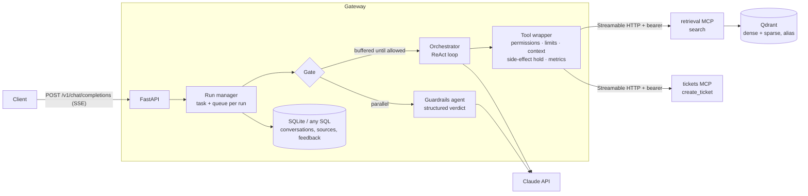

# mcp-agent-gateway

A streaming RAG agent gateway built on the [Model Context Protocol](https://modelcontextprotocol.io).
Ask a question over HTTP and watch live progress, the streamed answer, and numbered sources
arrive as Server-Sent Events. Behind the API, a ReAct-style agent (Claude) calls tools on MCP
servers, a guardrails agent checks the request in parallel, and nothing reaches the client or
touches the outside world until that check passes.

The demo corpus is the Kubernetes documentation, indexed into Qdrant with hybrid
(dense + BM25) search.



## What it demonstrates

| Pattern | Where |
|---|---|
| Streaming agent runs as background tasks; client disconnects don't lose the turn; `DELETE` cancels | `src/gateway/runs/` |
| Guardrails in parallel with the agent, output buffered until the verdict, fail closed on timeout | `src/gateway/agents/gate.py` |
| Side-effecting tools held until guardrails approve | `src/gateway/tools/wrapper.py` |
| Gateway-owned tool arguments (identity, conversation) hidden from the model and injected per call | `src/gateway/tools/context.py` |
| Per-tool call limits, timeouts, scopes, schema validation | `src/gateway/tools/wrapper.py` |
| Progress events generated from the tool call's own arguments | `src/gateway/agents/orchestrator.py` |
| Typed source contract, de-duplication and stable numbering for `[n]` citations | `src/gateway/agents/sources.py` |
| Title and follow-up markers parsed out of a token stream without leaking partial markers | `src/gateway/agents/stream_markers.py` |
| History modes (`questions_only`, `first_and_last`, `none`) and previous-source context | `src/gateway/agents/history_modes.py` |
| `local://` (in-process) and `http(s)://` MCP transports from one config | `src/gateway/tools/toolsets.py` |
| Retrieval overrides restricted to an allowlist; backend URL and keys server-side only | `mcp_servers/retrieval/overrides.py` |
| Atomic index swaps behind a Qdrant alias | `ingest/run.py` |
| OpenTelemetry traces (Langfuse via OTLP) and metrics, interrupted-span marking | `src/gateway/observability/` |
| Eval suites with an LLM judge and CI thresholds | `evals/` |

## Quickstart

### Docker Compose

```bash
cp .env.example .env          # add ANTHROPIC_API_KEY and replace the placeholder tokens
docker compose up -d --build --wait qdrant
docker compose --profile ingest run --rm ingest   # fetch + index the Kubernetes docs (once)
docker compose up -d --build
```

### Local (no Docker for the app)

Requires [uv](https://docs.astral.sh/uv/) and a Qdrant instance on `localhost:6333`.

```bash
uv sync
cp .env.example .env          # ANTHROPIC_API_KEY, GW_API_TOKENS
uv run python -m ingest.fetch && uv run python -m ingest.run
uv run python -m gateway.main  # MCP servers run in-process via local:// by default
```

### No API key? Offline demo mode

Set `GW_OFFLINE_LLM=true` in `.env` to run the whole stack without an Anthropic API key.
Both models are replaced by stand-ins: the "orchestrator" runs one real search with your
question and streams back the top passages with real `[n]` citations, and guardrails are a
few keyword rules. Everything else is the real pipeline (SSE, progress, the guardrails
gate, MCP over HTTP, source numbering, tickets, persistence, cancellation), which makes it
useful for smoke tests and demos. Answers are retrieved text, not model output, and the
gateway logs a warning at startup while it is on.

### Ask a question

```bash
TOKEN=replace-with-a-long-random-token   # a key from GW_API_TOKENS
curl -N http://localhost:8000/v1/chat/completions \
  -H "Authorization: Bearer $TOKEN" -H "Content-Type: application/json" \
  -d '{"message": "How do I make a Job retry failed pods fewer times?"}'
```

```text
event: run.started
data: {"type":"run.started","run_id":"9f…","conversation_id":"4c…","turn_id":"a1…"}

event: progress
data: {"type":"progress","tool":"search","title":"Looking up Job retry settings","detail":"…"}

event: title
data: {"type":"title","title":"Job retry limits"}

event: text.delta
data: {"type":"text.delta","text":"Set `spec.backoffLimit` on the Job [1]…"}

event: run.completed
data: {"type":"run.completed","answer":"…","sources":[{"number":1,"title":"Jobs","url":"https://kubernetes.io/docs/concepts/workloads/controllers/job/",…}],"followups":["…"],"title":"Job retry limits"}
```

Continue the conversation by sending `conversation_id`. Cancel a run with
`DELETE /v1/chat/completions/{run_id}` (the run id is in `run.started` and the `X-Run-Id` header).

## API

| Method | Path | Purpose |
|---|---|---|
| `POST` | `/v1/chat/completions` | Start a run; SSE stream of events |
| `DELETE` | `/v1/chat/completions/{run_id}` | Cancel your own running run |
| `GET` | `/v1/conversations` | Your conversations, newest first |
| `GET` | `/v1/conversations/{id}/messages` | Turns with answers, sources, follow-ups, status |
| `DELETE` | `/v1/conversations/{id}` | Delete a conversation |
| `POST` | `/v1/messages/{turn_id}/feedback` | `{"rating": "up" \| "down", "comment": "…"}` |
| `GET` | `/healthz` | Liveness |

Every stream ends with exactly one terminal event: `run.completed`, `run.blocked`,
`run.cancelled` or `run.failed`. Errors never include exception text or upstream payloads.

## Configuration

Process settings come from environment variables (`GW_*`, see `.env.example`). The agent
itself is defined in [`configs/agents/rag_assistant.yaml`](configs/agents/rag_assistant.yaml):
models and effort, limits, history mode, capabilities (MCP servers and per-tool policy),
feature flags and prompt files. `${env:VAR}` and `${env:VAR:-default}` are substituted at load,
unknown keys are rejected, and startup fails if any configured tool is missing on its server.

```yaml
- name: tickets
  url: ${env:TICKETS_MCP_URL:-local://tickets}
  token: ${env:TICKETS_TOKEN:-}
  tools:
    create_ticket:
      side_effect: true            # held until guardrails allow the request
      required_scope: tickets:write
      max_calls: 1
      context:                     # filled by the gateway, invisible to the model
        requester: user_id
        conversation_ref: conversation_id
```

The orchestrator runs on `claude-sonnet-5-5` and the guardrails classifier on `claude-haiku-5-5`
(a yes/no check doesn't need a large model); both use adaptive thinking, and either can be
switched to `claude-opus-5-5` in the YAML. The orchestrator uses server-side refusal fallbacks
(`models.fallbacks: default`, set to `null` to turn off).

## Security rules and their tests

| Rule | Test |
|---|---|
| Every API route except `/healthz` requires a valid bearer token | `tests/security/test_auth.py::test_gateway_requires_valid_bearer` |
| MCP servers refuse to start over HTTP without a token, and reject wrong tokens | `tests/security/test_auth.py`, `tests/integration/test_http_transport.py` |
| Users can't read, continue, delete, rate or cancel another user's conversations or runs | `tests/security/test_error_leakage.py`, `tests/integration/test_end_to_end.py` |
| Retrieval overrides outside the allowlist are rejected before the backend is called | `tests/security/test_retrieval_overrides.py`, `tests/unit/test_overrides.py` |
| Tool arguments are schema-checked; unknown tools and arguments are rejected | `tests/security/test_tool_wrapper.py::test_unknown_tool_and_args_rejected` |
| The model can't set gateway-owned arguments (identity, conversation) | `tests/security/test_tool_wrapper.py::test_model_cannot_set_context_args` |
| Missing context values fail loudly instead of sending empty values | `tests/unit/test_context.py` |
| Tools that need a scope can't be used without it | `tests/security/test_tool_wrapper.py::test_scope_required` |
| Per-run tool call limits and tool-round limits are enforced | `test_per_run_call_limit`, `test_tool_rounds_are_capped` |
| Nothing is streamed before the guardrails verdict; blocked runs show only `run.blocked` | `tests/unit/test_gate.py`, `test_blocked_request_streams_nothing_but_the_block` |
| Guardrails timeout or error blocks the request (fail closed) | `tests/unit/test_gate.py::test_fail_closed` |
| Side-effecting tools wait for the verdict and never run when blocked | `test_side_effect_held_until_release`, `test_ticket_never_created_when_blocked` |
| Errors return a stable code and generic message, never internals | `tests/security/test_error_leakage.py` |
| Oversized questions are rejected | `test_oversized_question_rejected` |
| Secrets are never committed (`.env` ignored, detect-secrets in pre-commit and CI) | `.pre-commit-config.yaml`, `.github/workflows/ci.yml` |

## Evals

```bash
uv run python -m evals.run --token "$TOKEN" --suite all      # needs the stack running
```

| Suite | Cases | Metrics | Threshold | Result |
|---|---|---|---|---|
| RAG | 20 | answer correct / grounded / cites expected page | 80% / 85% / 70% | _not run yet_ |
| Multi-turn | 8 | answer correct | 75% | _not run yet_ |
| Guardrails | 20 (10 allow, 10 block) | accuracy / false-block rate | 95% / ≤10% | _not run yet_ |

Answers are graded by an LLM judge returning a structured verdict, plus deterministic checks.
Reports land in `evals/reports/`. In CI the evals run on pull requests that touch prompts,
agent config or agent code, when an `ANTHROPIC_API_KEY` secret is configured.

## Development

```bash
uv sync
uv run pre-commit install
uv run ruff check . && uv run ruff format --check .
uv run pyright
uv run pytest            # 134 tests, no network or API key needed
```

Tests use a scripted fake model, a scripted guardrails classifier, and real MCP servers
in-process (plus one suite over real Streamable HTTP), with real SQLite.

## Project layout

```text
configs/        agent YAML and prompts
src/gateway/    API, run manager, agents, tool layer, config, persistence, auth, observability
mcp_servers/    retrieval (Qdrant hybrid search) and tickets (side-effecting demo) servers
ingest/         fetch, chunk, embed, load behind an alias
evals/          datasets, runner, thresholds
tests/          unit, security, integration
```

## License

MIT. The Kubernetes documentation used as the demo corpus is © The Kubernetes Authors,
licensed under [CC BY 4.0](https://creativecommons.org/licenses/by/4.0/); it is downloaded at
ingest time and not included in this repository.
